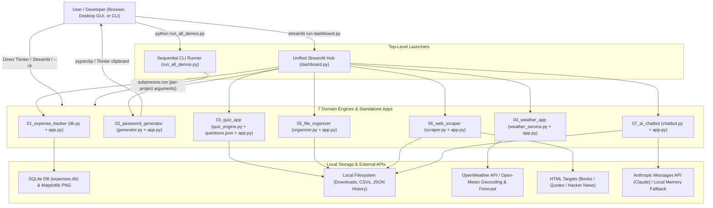
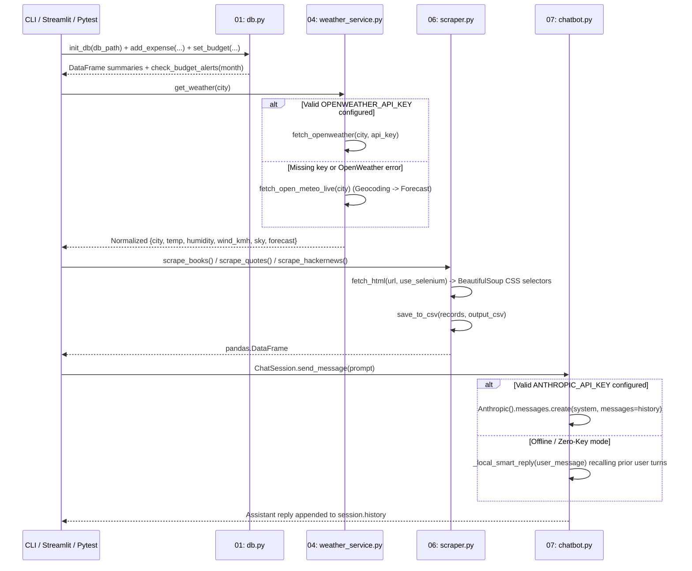

# 7 Python Mini Projects — Architecture & Module Reference

Reviewed 2026-11-08 against local source. Multi-project Python portfolio implementing 7 standalone CLI/GUI/Web applications (`01_expense_tracker` through `07_ai_chatbot`), a unified Streamlit launcher (`dashboard.py`), and a sequential CLI orchestrator (`run_all_demos.py`).

---

## 1. System Context & Data Flow (`graph TD`)



---

## 2. Execution & Multi-Backend Fallback Pipeline (`sequenceDiagram`)



---

## 3. Complete Module Breakdown

| Module Path | Lines | UI / Runtime Surface | Core Responsibilities & Key Symbols |
| :--- | :---: | :--- | :--- |
| ``dashboard.py`` | 166 | Streamlit Multi-App Hub | Injects `01..07` subdirectories into `sys.path` and provides a 7-option sidebar radio switcher unifying all 7 mini-projects in one browser UI. |
| ``run_all_demos.py`` | 48 | CLI Orchestrator | Executes all 7 project entry points sequentially with per-project CLI arguments via `subprocess.run` (`UTF-8` I/O enforced) and halts non-zero on failure. |
| ``01_expense_tracker/db.py`` | 199 | SQLite + Pandas Engine | Manages `expenses` and `budgets` tables (`CHECK(amount >= 0)`), `ON CONFLICT(category) DO UPDATE` upserts, monthly/category SQL aggregations, `OK`/`WARNING`/`EXCEEDED` budget alerts, and sample seeding. |
| ``01_expense_tracker/app.py`` | 145 | Streamlit + CLI + Matplotlib | Renders dual-panel horizontal bar + monthly trend charts (`Agg` backend) saved to `expense_report.png` (`--cli`) or interactive Streamlit forms. |
| ``02_password_generator/generator.py`` | 86 | CSPRNG Utility | Generates passwords via `secrets.choice` + `secrets.SystemRandom().shuffle` guaranteeing >= 1 character per enabled pool, scores strength (`0..7`: `Weak`/`Medium`/`Strong`), and copies via `pyperclip`. |
| ``02_password_generator/app.py`` | 103 | Tkinter Desktop GUI + CLI | Provides `Spinbox`/`Checkbutton` desktop interface with `root.clipboard_append` fallback when `pyperclip` is unavailable, plus `--cli --length` mode. |
| ``03_quiz_app/quiz_engine.py`` | 76 | Quiz State Machine | Loads JSON question banks (`load_questions`), supports deterministic seeded shuffling (`random.Random(seed)`), tracks per-question history & explanations, and evaluates `>= 70.0%` pass threshold (`QuizSession`). |
| ``03_quiz_app/app.py`` | 99 | Tkinter Desktop GUI + CLI | Interactive radio-button quiz window and deterministic `seed=42` `--cli` walkthrough over the 7-question ``questions.json`` bank. |
| ``04_weather_app/weather_service.py`` | 131 | Dual-Provider HTTP Client | Queries OpenWeather (`weather` + `forecast`) when `OPENWEATHER_API_KEY` is set, and transparently falls back to key-free Open-Meteo geocoding + 5-day WMO forecast (Open-Meteo); OpenWeather returns five forecast samples, not five days (`WMO_CODE_MAP`). |
| ``04_weather_app/app.py`` | 55 | Streamlit + CLI | Displays live temperature, apparent temperature, humidity, wind speed (`km/h`), and 5-day forecast table (`--cli --city`). |
| ``05_file_organizer/organizer.py`` | 120 | Filesystem + Watchdog Daemon | Maps extensions across 6 categories (`Images`, `Docs`, `Videos`, `Archives`, `Audio`, `Code` + `Others`), resolves filename collisions (`stem_1.ext`), supports `dry_run`, and runs real-time `watchdog.observers.Observer` (`AutoOrganizeHandler`). |
| ``05_file_organizer/app.py`` | 31 | CLI Utility | Supports `--folder`, `--dry-run`, and `--watch` flags, defaulting to creating and sorting a 9-file `demo_downloads` directory. |
| ``06_web_scraper/scraper.py`` | 93 | Requests / Selenium + BS4 | Fetches HTML via `requests` (custom `USER_AGENT`) or headless Chrome `selenium`, extracts structured dicts for Quotes, Books, and Hacker News (`[:15]`), and persists UTF-8 CSVs via Pandas (`save_to_csv`). |
| ``06_web_scraper/app.py`` | 35 | CLI Utility | Dispatches `--target {books,quotes,hn}` and optional `--selenium` flag, writing CSVs under `06_web_scraper/output/`. |
| ``07_ai_chatbot/chatbot.py`` | 62 | Anthropic SDK + Local Fallback | Maintains multi-turn `history: list[dict[str, str]]`, calls `Anthropic.messages.create` when `ANTHROPIC_API_KEY` is configured or `_local_smart_reply` offline, and exports JSON transcripts (`save_history`). |
| ``07_ai_chatbot/app.py`` | 62 | Streamlit Chat UI + CLI | Renders `st.chat_message` history with sidebar clear button, or runs a 2-turn memory demonstration saving `chat_history.json` (`--cli`). |

---

## 4. State Management Explanation

1. **Relational Persistence (`01_expense_tracker`)**: Durable state resides in SQLite (`expenses.db`, overrideable via `db_path: Path` on every function for isolated testing). Schema invariants (`amount >= 0`, `monthly_limit >= 0`, unique `budgets.category`) are enforced inside SQLite DDL.
2. **Session-Scoped Stateful Classes (`03_quiz_app`, `07_ai_chatbot`)**:
   - `QuizSession` encapsulates `questions`, `rng`, `current_index`, `score`, and `history` in instance attributes. In Streamlit (`dashboard.py`), the instance is persisted across reruns inside `st.session_state.quiz`; in Tkinter (`03_quiz_app/app.py`), it lives in closure scope for the lifetime of `root.mainloop()`.
   - `ChatSession` holds ordered `{role, content}` dictionaries in `self.history`, persisted across Streamlit reruns via `st.session_state.chat_session` / `st.session_state.hub_chat` and serializable to disk via `save_history(path)`.
3. **Stateless Functional Services & Filesystem Artifacts (`02`, `04`, `05`, `06`)**:
   - `generator.py`, `weather_service.py`, and `scraper.py` are stateless pure/I/O functions returning plain dicts or Pandas DataFrames.
   - `organizer.py` mutates only the explicitly passed `folder_path` directory tree (and supports side-effect-free `dry_run=True` previews).

---

## 5. Running & Verifying Tests Locally

```powershell
Set-Location 'C:\Users\ardhy\.gemini\antigravity\scratch\python-7-mini-projects'

# Run the entire pytest suite (baseline + comprehensive isolated unit & integration tests)
& 'C:\Python314\python.exe' -m pytest -q
```

The launcher currently has an app.py import collision in its expense branch. API failures propagate from the chatbot and can leave pending user history, while missing keys select its deterministic local reply mode. Weather fallback still requires network access. File-organizer watch mode operates on created events and has a producer-completion race. These current limitations are detailed in TECH_DEBT.md.
